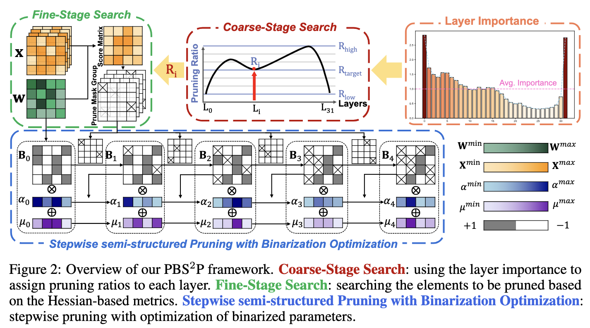

<div align="center">

# PBS2P: Progressive Binarization with Semi-Structured Pruning for LLMs

<a href="https://arxiv.org/abs/2502.01705"></a>
<a href="https://github.com/XIANGLONGYAN/PBS2P/releases/tag/v1"></a>
<a href="LICENSE"></a>

**Xianglong Yan, Tianao Zhang, [Zhiteng Li](https://zhitengli.github.io),
[Haotong Qin](https://htqin.github.io/), and
[Yulun Zhang](http://yulunzhang.com/)**

</div>

Official PyTorch implementation of the
**[PBS2P paper](https://arxiv.org/abs/2502.01705)**.

PBS2P compresses large language models below one bit per weight by combining:

- **SPBO** — Stepwise semi-structured Pruning with Binarization Optimization,
  which progressively applies an N:M pruning mask and re-optimizes the binary
  scales and offsets after every step.
- **CFS** — Coarse-to-Fine Search, which first allocates layer-wise pruning
  ratios and then selects weights with Hessian-based fine-stage scores.

<p align="center">
  
</p>

## Installation

The code was tested with Python 3.10, PyTorch 2.4.0, CUDA 12.1, and
Transformers 4.44.2.

```bash
conda create -n pbs2p python=3.10 -y
conda activate pbs2p
pip install -r requirements.txt
```

## Data preparation

Download WikiText2, PTB, and the C4 shards used for calibration and perplexity
evaluation:

```bash
python prepare_data.py --data-root ./data
```

You can also prepare a subset, for example:

```bash
python prepare_data.py --data-root ./data --datasets wikitext c4
```

Set `PBS2P_DATA_ROOT` if the datasets are stored elsewhere.

## Run PBS2P

The main entry point uses both SPBO and CFS by default. The following command
reproduces the paper's LLaMA-2-7B 6:8 configuration:

```bash
python run_pbs2p.py /path/to/Llama-2-7b-hf c4 \
  --data-root ./data \
  --device cuda:0 \
  --n 6 --m 8 \
  --results-file results/llama2-7b-6x8.json \
  --log-file logs/llama2-7b-6x8.log
```

Our verification run obtained perplexities of **7.20** on WikiText2,
**70.01** on PTB, and **9.52** on C4. Small differences from the paper can
arise from library and dataset revisions.

Other paper sparsity settings use `--n 4 --m 8` or `--n 5 --m 8`.
Pass `--save-model outputs/model-name` to save a compressed checkpoint.

Use `python run_pbs2p.py --help` for all options. A ready-to-edit example is
also provided in [`run.sh`](run.sh).

## Code structure

```text
pbs2p/
├── spbo.py          # Stepwise pruning and binarization optimization
├── cfs.py           # Coarse-stage layer allocation
├── gptq.py          # Fine-stage masks and GPTQ error compensation
├── grouping.py      # Binary weight-group search
├── pipeline.py      # Layer-wise compression pipeline
├── data.py          # Calibration/evaluation data loaders
└── eval_ppl.py      # Memory-efficient perplexity evaluation
```

## Citation

```bibtex
@article{yan2025pbs2p,
  title   = {Progressive Binarization with Semi-Structured Pruning for LLMs},
  author  = {Yan, Xianglong and Zhang, Tianao and Li, Zhiteng and
             Qin, Haotong and Zhang, Yulun},
  journal = {arXiv preprint arXiv:2502.01705},
  year    = {2025}
}
```

## Acknowledgements

This implementation builds on ideas and code from
[BiLLM](https://github.com/Aaronhuang-778/BiLLM) and
[ARB-LLM](https://github.com/ZHITENGLI/ARB-LLM). We thank the authors for
their open-source contributions.

PBS2P is released under the [Apache 2.0 License](LICENSE). Upstream copyright
notices are retained in [NOTICE](NOTICE).