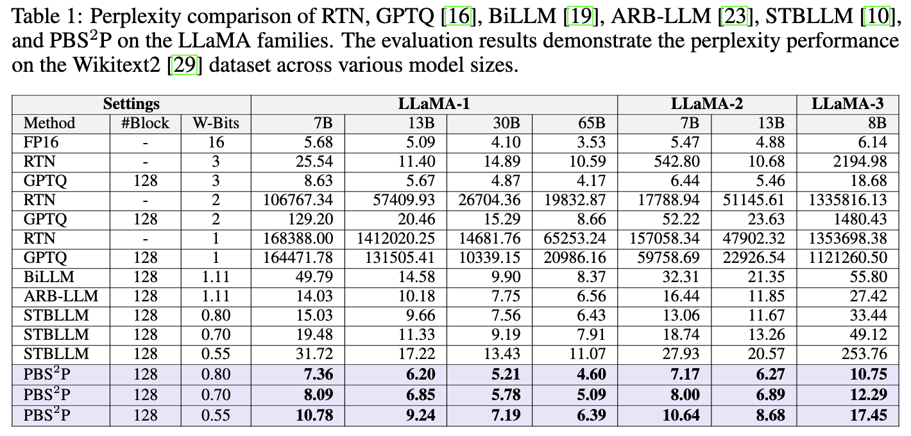
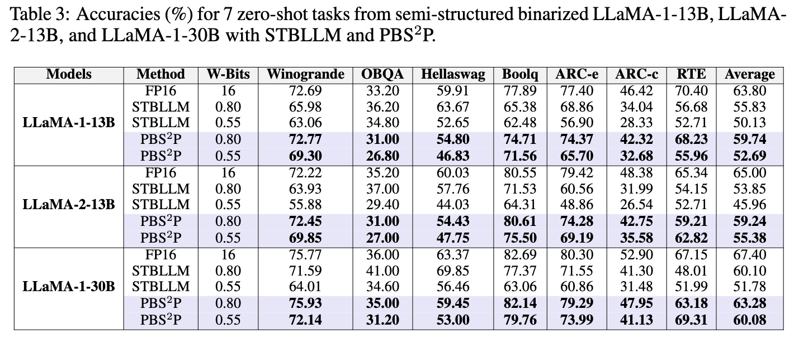

<div align="center">

# Progressive Binarization with Semi-Structured Pruning for LLMs

<a href="https://arxiv.org/abs/2502.01705"></a>
<a href="https://github.com/XIANGLONGYAN/PBS2P/releases/tag/v1"></a>
<a href="https://github.com/XIANGLONGYAN/PBS2P"></a>
<a href="https://github.com/XIANGLONGYAN/PBS2P/blob/main/LICENSE"></a>


**Xianglong Yan, Tianao Zhang, [Zhiteng Li](https://zhitengli.github.io), [Haotong Qin](https://htqin.github.io/), and [Yulun Zhang](http://yulunzhang.com/)**

</div>

---

## 🔥 News

- **2025-02-03:** This repo is released. Paper available on [arXiv](https://arxiv.org/abs/2502.01705).

---

## 📖 Abstract

Large language models (LLMs) have achieved remarkable success in natural language processing tasks, but their high computational and memory demands pose challenges for deployment on resource-constrained devices. Binarization, as an efficient compression method that reduces model weights to just **1 bit**, significantly lowers both computational and memory requirements. Despite this, the binarized LLM still contains redundancy, which can be further compressed. Semi-structured pruning provides a promising approach to achieve this, offering a better trade-off between model performance and hardware efficiency.

However, simply combining binarization with semi-structured pruning can lead to a significant performance drop. To address this, we propose **PBS<sup>2</sup>P** — a **P**rogressive **B**inarization with **S**emi-**S**tructured **P**runing method for LLM compression, consisting of:

- **SPBO**: Stepwise semi-structured Pruning with Binarization Optimization — reduces total error caused by pruning and binarization, even below that of the no-pruning scenario.
- **CFS**: Coarse-to-Fine Search — selects pruning elements more effectively.

Extensive experiments demonstrate that **PBS<sup>2</sup>P** achieves superior accuracy across various LLM families and evaluation metrics, noticeably outperforming state-of-the-art (SOTA) binary PTQ methods.

<p align="center">
  
</p>

---

## ⚒️ TODO

- [ ] Release post-training quantization code
- [ ] Release pretrained models
- [x] Release paper (arXiv)
- [x] Release results

---

## 🔗 Contents

- [ ] [Post-Training Quantization Code](#)
- [ ] [Pretrained Models](#)
- [x] [Results](#-results)
- [x] [Citation](#-citation)
- [x] [Acknowledgements](#-acknowledgements)

---

## 🔎 Results

<details>
<summary><b>PBS<sup>2</sup>P achieves superior perplexity performance on WikiText2 datasets</b> (click to expand)</summary>
<p align="center">
  
</p>
</details>

<details>
<summary><b>PBS<sup>2</sup>P achieves superior average accuracy on 7 zero-shot QA datasets</b> (click to expand)</summary>
<p align="center">
  
</p>
</details>

---

## 📝 Citation

If you find this work helpful in your research, please consider citing:

```bibtex
@article{yan2025progressivebinarizationsemistructuredpruning,
  title     = {Progressive Binarization with Semi-Structured Pruning for LLMs},
  author    = {Xianglong Yan and Tianao Zhang and Zhiteng Li and Yulun Zhang},
  year      = {2025},
  eprint    = {2502.01705},
  archivePrefix = {arXiv},
  primaryClass  = {cs.LG},
  url       = {https://arxiv.org/abs/2502.01705},
}
```

---

## 💡 Acknowledgements

This work is released under the [Apache 2.0 License](LICENSE).

<div align="center">

⭐ If you find this repository helpful, please consider giving it a star!

</div>
